# Hello, I'm Robin ! :wave:

**Software Engineer - Geospatial, Distributed Systems & AI** @ **Zelin Marine** :ship:

I am 23 years old and passionate about full stack development, deep learning, and graphical computing.

- :briefcase: Software Engineer at **Zelin Marine**, building a ship route optimization platform (weather routing, AIS vessel tracking, map visualization)
- :mortar_board: Graduated from **EPITECH, Bordeaux & Paris, France** (2020-2025), Master's degree in Computer Science
- :airplane: 1 year as an CS International Student at **Inha University, Incheon, Korea** (2023-2024)
- :book: Keep learning

## My tools 💻:

### Languages

  
  
  
  <a href="https://www.python.org/" target="_blank" rel="noreferrer">
    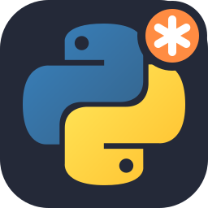
  </a>
  <a href="https://www.typescriptlang.org/" target="_blank" rel="noreferrer">
    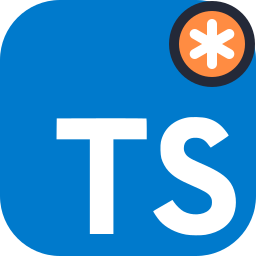
  </a>
  <a href="https://www.khronos.org/opengl/wiki/OpenGL_Shading_Language" target="_blank" rel="noreferrer">
    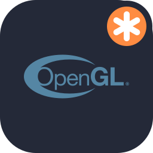
  </a>
  
  
  
  
  

### Frameworks and librairies

  <a href="https://angular.dev/" target="_blank" rel="noreferrer">
    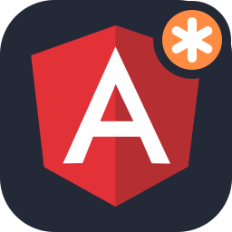
  </a>
  <a href="https://nodejs.org/" target="_blank" rel="noreferrer">
    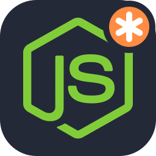
  </a>
  
  
  
  
  
  <a href="https://numpy.org/" target="_blank" rel="noreferrer">
    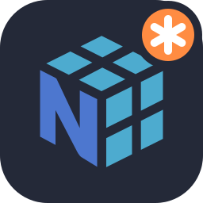
  </a>
  
  
  
  
  

### Geospatial / Cartography

  
  <a href="https://deck.gl/" target="_blank" rel="noreferrer">
    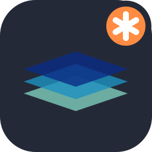
  </a>
  
  <a href="https://developmentseed.org/titiler/" target="_blank" rel="noreferrer">
    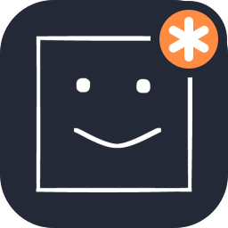
  </a>
  
  <a href="https://rasterio.readthedocs.io/" target="_blank" rel="noreferrer">
    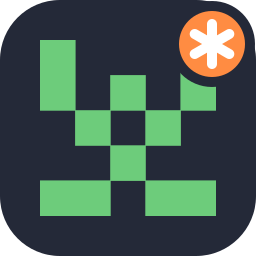
  </a>

### DevOps / Build Tools

  <a href="https://git-scm.com/" target="_blank" rel="noreferrer">
    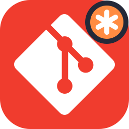
  </a>
  <a href="https://www.docker.com/" target="_blank" rel="noreferrer">
    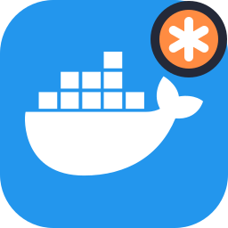
  </a>
  
  
  
  <a href="https://www.sonarsource.com/products/sonarqube/" target="_blank" rel="noreferrer">
    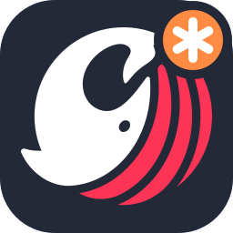
  </a>
  

### Infrastructure / Web Tools

  
  <a href="https://redis.io/" target="_blank" rel="noreferrer">
    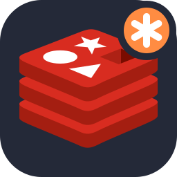
  </a>
  <a href="https://www.keycloak.org/" target="_blank" rel="noreferrer">
    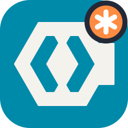
  </a>
  
  
  
  
  

### Softwares / IDE

  
  
  
  <a href="https://claude.ai/" target="_blank" rel="noreferrer">
    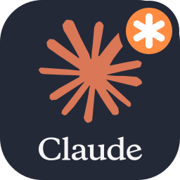
  </a>
  <a href="https://qgis.org/" target="_blank" rel="noreferrer">
    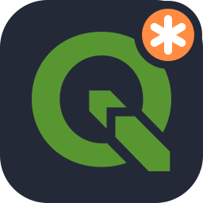
  </a>
  
  
  
  
  
  
  

### Environments

  
  <a href="https://fr.wikipedia.org/wiki/Microsoft_Windows" target="_blank" rel="noreferrer">
    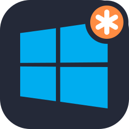
  </a>
  
  

 used daily at <b>Zelin Marine</b>

  
  

## 📫 How to reach me:

  
  

